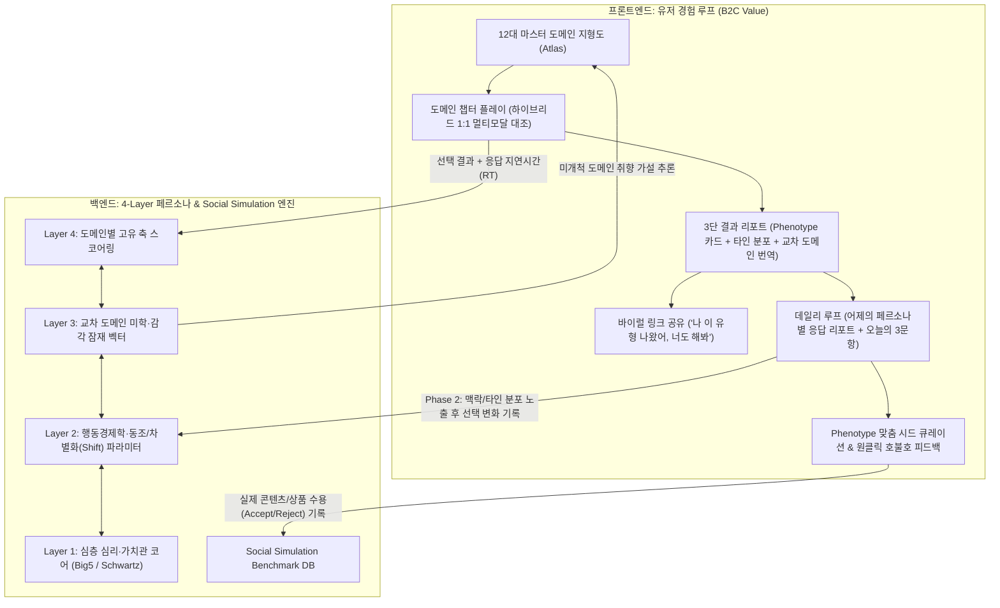

> **Historical planning document, superseded where noted.** The research/data-use and response-latency-to-personality proposals below are historical ideas, not current product behavior or permission to use personal responses for research. The current data-use decision is documented in [AUTH_LAUNCH_READINESS.md](AUTH_LAUNCH_READINESS.md); the bounded remaining release scope is in [COMPLETION_PLAN.md](COMPLETION_PLAN.md). The historical body is retained for context.

# 마스터 기획서 & 4-Layer / 12-Domain 스키마 설계도

> [!IMPORTANT]
> **이중 목적 아키텍처 (Dual-Purpose Engine)**
> * **User-Facing (B2C Flywheel):** 내가 잘 모르는 분야(패션, 영화, 문학 등)에서도 도메인 지형도를 이해하고, 내가 이미 확고한 분야(음악, AI, 경제 등)의 감각을 다리 삼아 ‘나만의 취향과 심지(Phenotype)’를 매일 조금씩 발견·확장하는 **자기 이해 및 맞춤 큐레이션 웹앱**
> * **Research-Facing (Social Simulation Engine):** 기존 LLM이 모사하지 못하는 **인간의 다차원 페르소나 벡터, 도메인 간 상관관계, 선택 확신도(Response Latency), 사회적 입력에 따른 행동 변화(Shift), 실제 추천 수용률**을 자연스럽게 수집하는 **Ground-Truth 인간 행동 데이터 파이프라인**

---

## 1. 전체 시스템 아키텍처 다이어그램



---

## 2. 4-Layer 과학적 페르소나 Taxonomy 상세 명세

### Layer 1: 심층 심리·가치관 코어 (Deep Psychometric & Value Core)
가장 밑바탕에서 장기적 일관성을 유지하는 기저 변수입니다. 유저에게 직접 딱딱한 설문으로 묻지 않고, Layer 4의 선택들을 통해 잠재 변수(Latent Variable)로 추론·갱신합니다.

| 프레임워크 | 핵심 차원 (Axes) | 범위 | Social Simulation 역할 |
| :--- | :--- | :--- | :--- |
| **Big Five (OCEAN)** | • `openness` (경험 개방성)<br>• `conscientiousness` (성실성/구조 선호)<br>• `extraversion` (외향성/자극 추구)<br>• `agreeableness` (우호성/조화 추구)<br>• `neuroticism` (정서적 민감성) | `[-1.0, +1.0]` | 에이전트의 기본 인지 반응성, 낯선 자극 수용도, 감정적 진폭 결정 |
| **Schwartz 기본 인간 가치** | • `self_transcendence_vs_enhancement` (자기초월 ↔ 자기고양/성취)<br>• `openness_vs_conservation` (변화/자율 ↔ 안정/전통/보수) | `[-1.0, +1.0]` | 가치관 충돌 및 딜레마 상황에서의 우선순위 결정 |
| **Haidt 도덕성 기반** | • `care` (배려), `fairness` (공정), `loyalty` (충성), `authority` (권위), `liberty` (자유) | `[0.0, 1.0]` | 사회적 이슈·윤리적 논쟁에서의 판단 기준 |

---

### Layer 2: 행동경제학 & 사회적 민감도 파라미터 (Behavioral & Shift Engine)
게오르크 지멜의 유행 이론과 행동경제학을 결합한 계층으로, **‘특정 입력이 주어졌을 때 얼마나, 어느 방향으로 흔들리는가(Shift)’**와 **‘예외적 행동 가능성’**을 결정합니다.

| 파라미터 키 | 설명 (측정 지표) | 측정 방식 (Phase 1 → Phase 2) |
| :--- | :--- | :--- |
| `social_conformity` | **동조성(+) vs 차별화 욕구(-)**<br>(지멜의 모방 vs 개성 축) | • Phase 1: 대중적 스테디셀러 vs 마이너/독창적 선택지 선호도<br>• Phase 2: "다수(80%)가 B를 골랐다"는 정보 노출 시 선택 변경 확률 |
| `authority_sensitivity` | **전문가·권위 수용도**<br>(평론가/브랜드 권위 vs 자기 직관) | • 라벨/배경 설명 유무에 따른 선호도 차이 및 전문가 추천 수용률 |
| `risk_aversion` | **위험 회피도(+) vs 리스크 감수(-)** | • 경제/소비/여행/커리어 챕터의 불확실성 선택 문항 |
| `time_discounting` | **현재 지향/충동(+) vs 미래 지향/인내(-)** | • 즉각적 보상/자극 vs 장기적 축적/깊이 선택 문항 |
| `domain_conviction[d]` | **도메인 $d$에 대한 내면의 심지(확신도)** | • **Zero-Friction 측정:** 해당 도메인 1:1 선택 시 평균 응답 속도($\text{RT}^{-1}$) 및 축 일관성 점수 |

---

### Layer 3: 교차 도메인 미학·감각 축 (Cross-Domain Aesthetic Bridge)
**‘내가 아는 도메인(음악, AI)’에서 ‘내가 모르는 도메인(패션, 영화, 문학)’으로 취향을 번역해 주는 핵심 다리(Bridge)**입니다. Rentfrow & Gosling의 MUSIC 모델, Berlyne의 실험미학, 부르디외의 미학적 성향을 통합한 5개 직교 축입니다.

1. **`complexity` (구조적 복잡성 ↔ 미니멀/단순성)**: 다층적 디테일·복합 구조 vs 여백·절제·단순 명쾌함
2. **`novelty` (아방가르드/실험성 ↔ 클래식/전통성)**: 낯선 형식·파격·미래지향 vs 검증된 고전·익숙한 문법
3. **`intensity` (강렬함/고자극 ↔ 온화함/Mellow)**: 강한 대비·긴장감·역동성 vs 부드러운 톤·편안함·이완
4. **`conceptualism` (개념/상징/맥락 중심 ↔ 직관/기능/본질 중심)**: 숨겨진 서사·철학적 의미·상징 소비 vs 즉각적 감각·실용성·물질적 본질 (부르디외의 형식미 vs 기능미)
5. **`warmth` (유기적/인간적 온기 ↔ 기하학적/차갑고 정교한 이성)**: 자연 소재·감성적 서사·아날로그 vs 금속/디지털·논리적 구조·모던함

---

### Layer 4: 12대 마스터 도메인 & 도메인별 주류 분석 프레임워크 (Master Domain Atlas)
부르디외의 《구별짓기》 문화 소비 도메인과 Wells & Tigert의 AIO 라이프스타일 분류를 결합한 12개 마스터 도메인입니다. **각 도메인은 실제 해당 학계·업계에서 사용하는 주류 방법론의 축(Axes)을 그대로 사용**합니다.

#### Pillar I. 감각 & 공간 미학 (Sensory & Material)

| # | 도메인 | 적용된 주류 분석 방법론 | 측정 핵심 축 (Axes) | 대표 Phenotype 예시 (유형 카드) |
| :-: | :--- | :--- | :--- | :--- |
| **1** | **패션·스타일**<br>*(Fashion & Style)* | 복식미학 & 이미지 컨설팅 분류 체계 | • **구조감:** 테일러드/구축적 ↔ 드레이프/유연한 핏<br>• **장식성:** 미니멀/절제 ↔ 맥시멀/레이어드<br>• **시대·태도:** 클래식/헤리티지 ↔ 스트릿/아방가르드<br>• **색채감:** 모노톤/저채도 ↔ 포인트/고대비 | • `구조적 미니멀리스트`<br>• `헤리티지 클래식 큐레이터`<br>• `어반 유틸리티 탐험가`<br>• `아방가르드 해체주의자` 등 |
| **2** | **공간·인테리어**<br>*(Space & Interior)* | 환경심리학 & 실내건축 스타일 분류 | • **밀도:** 비움/미니멀 ↔ 수집/맥시멀 라이프<br>• **물성:** 바이오필릭(우드·식물·자연광) ↔ 모던 인더스트리얼(메탈·무채색·조명)<br>• **동선 기능:** 개방적 소셜 라운지 ↔ 독립적 안식처(벙커) | • `바이오필릭 안식처 건축가`<br>• `모던 갤러리 미니멀리스트`<br>• `빈티지 아카이브 수집가` 등 |
| **3** | **미식·식음료·향**<br>*(Gastronomy & Scent)* | 부르디외 식문화론 & 관능검사(Sensory Evaluation) | • **지향점:** 본질적 포만감·직관적 맛(Comfort) ↔ 섬세한 레이어·형식미(Fine/Artisanal)<br>• **미식 모험도:** 검증된 소울푸드 ↔ 미지의 향신료·페어링 탐험<br>• **향/풍미 노트:** 프레시·시트러스·클린 ↔ 우디·스모키·복합 발효 | • `아티장 테이스팅 탐험가`<br>• `본질주의 소울푸드 미식가`<br>• `스모키 & 우디 노트 수집가` 등 |
| **4** | **시각예술·색채·디자인**<br>*(Visual Art & Design)* | Berlyne 미학 모델 & 형식주의 예술이론 | • **재현성:** 구상/사실적 묘사 ↔ 추상/기하학적 은유<br>• **시각 질서:** 대칭·조화·바우하우스식 기능미 ↔ 비대칭·파격·표현주의<br>• **색온도/질감:** 따뜻한 아날로그 질감 ↔ 차갑고 매끈한 디지털 그래픽 | • `바우하우스 질서주의자`<br>• `몽환적 색채 인상주의자`<br>• `개념적 추상 탐구자` 등 |

#### Pillar II. 문화 & 서사·여가 (Cultural & Narrative)

| # | 도메인 | 적용된 주류 분석 방법론 | 측정 핵심 축 (Axes) | 대표 Phenotype 예시 (유형 카드) |
| :-: | :--- | :--- | :--- | :--- |
| **5** | **음악·사운드**<br>*(Music & Sound)* | **Rentfrow & Gosling MUSIC 5차원 모델** + 오디오 피처 | • **Mellow vs Intense:** 온화·칠(Chill) ↔ 강렬·고에너지<br>• **Unpretentious vs Sophisticated:** 직관적 멜로디·어쿠스틱 ↔ 복잡한 화성·변칙 구조<br>• **Contemporary vs Timeless:** 현대적 전자음·그루브 ↔ 클래식·시대를 타지 않는 사운드 | • `정교한 사운드 아키텍트`<br>• `새벽 감성 멜로우 유영자`<br>• `고밀도 리듬 에너지 수집가` 등 |
| **6** | **영화·영상 서사**<br>*(Film & Narrative)* | 서사학(Narratology) & 영화이론 장르 수용 모델 | • **중심축:** 치밀한 플롯·떡밥 회수·속도감 ↔ 미장센·분위기·인물 심리선<br>• **세계관:** 현실 밀착 리얼리즘 ↔ SF·판타지·거대 세계관<br>• **여운의 방식:** 명쾌한 카타르시스·해소 ↔ 모호한 열린 결말·철학적 질문 | • `치밀한 플롯 설계 해독가`<br>• `미장센과 여백의 관찰자`<br>• `거대 세계관 몰입 탐험가` 등 |
| **7** | **문학·텍스트·인문**<br>*(Literature & Text)* | 독자반응이론 & 문학 문체론(Stylistics) | • **문체 선호:** 건조하고 명확한 단문·논리 ↔ 서정적이고 은유적인 만연체·감각<br>• **독서 목적:** 인간 내면과 실존적 성찰 ↔ 세계의 작동 원리·지적 프레임 확장<br>• **서사 톤:** 서늘한 사회 해부·비평 ↔ 다정한 연대·회복의 서사 | • `서늘한 문장의 실존 탐구가`<br>• `지적 프레임 수집가`<br>• `서정적 은유와 온기의 독자` 등 |
| **8** | **여행·신체활동·레저**<br>*(Travel & Body Culture)* | Plog 여행자 심리 모델(Allocentric ↔ Psychocentric) & 부르디외 스포츠 사회학 | • **여행 스펙트럼:** 낯선 미개척지·즉흥 탐험 ↔ 완벽한 휴양·검증된 럭셔리/플랜<br>• **신체 활동:** 개인적 수련·통제·몰입(요가·러닝·등산) ↔ 역동적 교류·경쟁·전술(팀 스포츠)<br>• **에너지 충전:** 정적 고립·자연 ↔ 도시의 활기·문화 핫플레이스 | • `미지의 로컬 방랑자`<br>• `고밀도 단독 수련가`<br>• `어반 큐레이션 여행자` 등 |

#### Pillar III. 지성 & 의사결정·관계 (Cognitive, Social & Economic)

| # | 도메인 | 적용된 주류 분석 방법론 | 측정 핵심 축 (Axes) | 대표 Phenotype 예시 (유형 카드) |
| :-: | :--- | :--- | :--- | :--- |
| **9** | **과학·기술·미래 (AI/우주)**<br>*(Tech, Science & Future)* | 혁신확산이론(Rogers) & 기술철학 프레임워크 | • **기술 수용 태도:** 가속주의·얼리어답터·낙관론 ↔ 인간 중심 성찰·신중론<br>• **호기심 스케일:** 당장 쓸 수 있는 실용 공학·생산성 ↔ 우주·기원·양자 등 근원적 호기심<br>• **시스템 관점:** 효율·최적화 중심 ↔ 창발성·예측 불가능성 선호 | • `코스믹 호기심의 가속주의자`<br>• `실용적 시스템 최적화 설계자`<br>• `인간 중심 테크 성찰가` 등 |
| **10** | **경제·소비·리스크**<br>*(Economy & Consumption)* | 행동경제학 프로스펙트 이론 & 소비자 의사결정 스타일(CSI) | • **리스크 태도:** 비대칭 고수익 베팅(High-risk/High-return) ↔ 하방 방어·안전 자산 선호<br>• **소비 효용:** 가성비·스펙·실용주의 ↔ 스토리·희소성·심미적 프리미엄<br>• **시간 지평:** 현재의 경험 극대화 ↔ 장기 복리·자유를 위한 유예 | • `비대칭 기회에 베팅하는 전략가`<br>• `가치 대비 본질을 꿰뚫는 실용가`<br>• `경험과 안목에 투자하는 심미주의자` 등 |
| **11** | **인간관계·소통·일(Work)**<br>*(Relationships & Work)* | 성인 애착 이론 & Thomas-Kilmann 갈등·협업 모델 | • **관계 거리감:** 좁고 깊은 소수 정예·독립 공간 필수 ↔ 넓고 유연한 네트워크·연결감<br>• **소통 문법:** 직설적 팩트·문제 해결 중심 ↔ 맥락·감정선·배려 중심<br>• **일하는 방식:** 자율적 딥워크·개인 돌파 ↔ 치열한 브레인스토밍·팀 시너지 | • `독립적 딥워크 장인`<br>• `핵심만 찌르는 전략적 조율가`<br>• `온기와 맥락을 잇는 커뮤니티 빌더` 등 |
| **12** | **사회·윤리·삶의 철학**<br>*(Ethics & Philosophy)* | Schwartz 가치 체계 & 도덕 심리학(공리주의 vs 의무론) | • **판단 기준:** 결과주의·전체 효율(공리) ↔ 원칙·절차적 정의·개인의 권리<br>• **변화관:** 기존 질서 해체·혁신 ↔ 검증된 전통·공동체 안정<br>• **행복의 정의:** 탁월성 성취·영향력 확장 ↔ 내면의 평정(아타락시아)·일상의 충만함 | • `원칙과 자율의 스토아 철학자`<br>• `실용적 해법을 찾는 결과주의자`<br>• `조화와 연대의 휴머니스트` 등 |

---

## 3. 핵심 인터랙션 메커니즘 상세 설계

### 3.1 도메인 챕터 내부: 하이브리드 1:1 멀티모달 대조 (총 8~10 라운드, 1분 컷)
* **전반부 (Round 1~6 또는 1~8): 축(Axis) 측정 라운드**
  * 해당 도메인의 핵심 축별로 가장 대비되는 두 카드(시각 무드보드 + 2줄 감각/상황 묘사)를 1:1로 제시합니다.
  * 전문 용어(예: "해체주의", "미장센", "공리주의")를 숨기고 **순수한 감각·상황적 끌림**으로 고르게 합니다.
* **후반부 (Round 7~8 또는 9~10): 결승 결정전 (Finalist Tie-Breaker)**
  * 전반부 응답으로 좁혀진 상위 2~4개 후보 Phenotype의 대표 카드를 맞붙여 최종 Phenotype과 대표 이미지를 확정합니다.
* **백그라운드 Zero-Friction 로깅 (Social Simulation 핵심 피처):**
  * 각 라운드마다 `shown_at`부터 `selected_at`까지의 **응답 지연시간(`response_time_ms`)**을 기록합니다.
  * $\text{RT} < 1500\text{ms}$는 확고한 선호(높은 심지), $\text{RT} > 4000\text{ms}$는 경계선상의 선호(외부 자극 시 Shift 가능성 높음)로 정량화합니다.

### 3.2 챕터 완료: 3단 결과 리포트 & 교차 도메인 번역
1. **Part 1. MBTI식 Phenotype 카드 (바이럴 공유용)**
   * 직관적인 유형 명칭(예: `[패션] 구조적 미니멀리스트`), 핵심 감각 키워드 3개, 한 줄 정의
2. **Part 2. 타인과의 분포 비교 (Social Proof & 호기심)**
   * *"전체 참여자 중 11.4%만 속하는 희소 유형이에요."*
   * *"Round 4에서 대중의 78%는 화려한 레이어드(A)를 골랐지만, 당신은 0.9초 만에 절제된 실루엣(B)을 골랐어요."*
3. **Part 3. 도메인 지형도 & 아는 도메인과의 연결 (Cross-Domain Bridge)**
   * 해당 도메인의 전체 지형도 위에서 내 위치를 시각적으로 보여주고, 내가 몰랐던 사조/키워드의 이름을 알려줍니다.
   * 이미 완료한 다른 도메인이 있다면: *"당신이 [음악]과 [AI/기술]에서 보여준 '군더더기 없는 구조미(Complexity -0.6, Conceptualism +0.7)' 성향이 패션에서는 이런 스타일로 발현됩니다."*라고 연결해 줍니다.
   * 아직 안 해본 도메인이 있다면: *"이 성향을 가진 분들은 [영화]에서는 '미장센 관찰자' 유형이 나올 확률이 83%예요. 맞는지 확인해 볼까요?"*라며 다음 도메인 탐험을 유도합니다.

### 3.3 데일리 리텐션 루프 & Phase 2 Shift 실험장
요일별 도메인 로테이션 테마에 맞춰 매일 1~2분 분량의 루프가 돌아갑니다.
1. **[어제의 페르소나 리포트]**
   * 단순 전체 통계가 아닌 **페르소나 교차 통계**를 보여줍니다.
   * 예: *"어제 질문(신작 영화 A vs B)에서 전체 대중은 69%가 A를 골랐는데, 신기하게도 당신 같은 [구조적 미니멀리스트] 그룹만 81%가 B를 골랐어요!"*
2. **[오늘의 질문 (1~3문항)]**
   * 오늘의 트렌드/딜레마/감각 질문 1~3개 제시.
   * **(Phase 2 확장 시)** 특정 문항에서는 선택 직후 *"만약 당신과 같은 유형의 85%가 반대쪽을 골랐다면, 선택을 바꾸시겠어요?"* 또는 프레이밍을 달리한 후속 질문을 던져 **실제 Shift($\Delta$) 데이터**를 수집합니다.
3. **[오늘의 Phenotype 시드 큐레이션 & 호불호 피드백]**
   * 내 Phenotype에 매핑된 시드 아이템(옷 스타일/브랜드, 곡, 영화, 책, 아티클)을 추천하고, 하단의 `[🔥 내 취향 맞음]` / `[🤔 이건 별로]` 원클릭 피드백을 통해 **실제 수용률(Ground-truth Acceptance)**을 기록합니다.

---

## 4. 백엔드 데이터베이스 & Social Simulation 스키마 설계

```sql
-- 1. 유저 및 4-Layer 잠재 페르소나 벡터 테이블
CREATE TABLE user_personas (
    user_id TEXT PRIMARY KEY,
    auth_provider TEXT, -- 'anonymous', 'kakao', 'google'
    created_at TIMESTAMP DEFAULT CURRENT_TIMESTAMP,
    -- Layer 1: Psychometric & Values (JSON: openness, conscientiousness, etc.)
    layer1_core_json TEXT NOT NULL,
    -- Layer 2: Behavioral & Shift Params (JSON: social_conformity, risk_aversion, domain_conviction)
    layer2_behavior_json TEXT NOT NULL,
    -- Layer 3: Cross-Domain Aesthetic Vector (JSON: complexity, novelty, intensity, conceptualism, warmth)
    layer3_aesthetic_json TEXT NOT NULL,
    -- Layer 4: Completed Domain Phenotypes & Axis Scores (JSON per domain 1..12)
    layer4_domains_json TEXT NOT NULL
);

-- 2. 도메인 챕터 & 1:1 대조 문항 테이블
CREATE TABLE contrast_questions (
    question_id TEXT PRIMARY KEY,
    domain_id INTEGER NOT NULL, -- 1 to 12
    round_type TEXT NOT NULL,   -- 'axis_measurement' | 'finalist_tiebreaker' | 'daily_pulse'
    target_axis TEXT NOT NULL,  -- 측정 대상 축 (예: 'structure_vs_drape')
    option_a_json TEXT NOT NULL, -- { title, subtitle, image_url, audio_url, axis_weights, layer3_weights }
    option_b_json TEXT NOT NULL
);

-- 3. Social Simulation용 선택 행동 텔레메트리 로그 (핵심 연구 데이터셋)
CREATE TABLE choice_telemetry (
    log_id TEXT PRIMARY KEY,
    user_id TEXT NOT NULL,
    question_id TEXT NOT NULL,
    domain_id INTEGER NOT NULL,
    selected_option TEXT NOT NULL,       -- 'A' | 'B'
    response_time_ms INTEGER NOT NULL,   -- 선택까지 걸린 밀리초 (확신도 지표)
    persona_snapshot_json TEXT NOT NULL, -- 선택 시점의 유저 4-Layer 벡터 스냅샷
    context_intervention TEXT,           -- Phase 2용: NULL(순수 선택) | 'social_proof_majority_B' | 'expert_authority_A' 등
    shifted_from_option TEXT,            -- Phase 2용: 개입 전 초기 선택값 (Shift 발생 여부 측정)
    created_at TIMESTAMP DEFAULT CURRENT_TIMESTAMP
);

-- 4. Phenotype별 시드 큐레이션 & 실제 수용도 피드백 테이블
CREATE TABLE curation_feedback (
    feedback_id TEXT PRIMARY KEY,
    user_id TEXT NOT NULL,
    domain_id INTEGER NOT NULL,
    phenotype_id TEXT NOT NULL,
    item_id TEXT NOT NULL,
    reaction TEXT NOT NULL, -- 'accept_like' | 'reject_dislike' | 'click_outbound'
    persona_snapshot_json TEXT NOT NULL,
    created_at TIMESTAMP DEFAULT CURRENT_TIMESTAMP
);
```

---

## 5. 2단계: MVP 웹앱 프로토타입 구현 계획 (`/Users/sangminlee/Projects/tempname`)

기획서를 승인(Proceed)해 주시면 바로 `/Users/sangminlee/Projects/tempname` 워크스페이스에 실제로 플레이하고 테스트할 수 있는 **반응형 모바일 퍼스트 웹앱 MVP**를 구현합니다.

1. **프로젝트 구조 & 스택:**
   * 직관적이고 빠른 실행·배포를 위한 **Next.js (App Router, TypeScript, Tailwind CSS)** + 로컬/서버리스 호환 **SQLite (또는 JSON/Prisma 기반 로컬 스토어)** 구조
2. **핵심 구현 범위 (MVP Phase 1):**
   * **12대 마스터 도메인 지형도(Atlas) 홈 화면:** 완료한 도메인 배지, 미완료 도메인에 대한 **‘AI 교차 도메인 취향 예측(가설)’** 표시
   * **도메인 챕터 플레이어 (하이브리드 1:1 대조 UI):** 멀티모달 카드(비주얼 무드 + 2줄 감각 묘사), 밀리초 단위의 **Response Latency(`response_time_ms`) 자동 측정**, 전반부 축 측정 → 후반부 결승전 전환 로직
   * **3단 결과 리포트 & 공유 카드 뷰:** 도메인별 Phenotype 카드, 타인 대비 내 선택의 특이점 통계, 내가 이미 깬 도메인(예: 음악, AI, 경제)과 모르는 도메인(예: 패션, 영화, 문학)을 연결해 주는 **Cross-Domain 번역 리포트**
   * **데일리 루프 뷰 (어제의 페르소나 리포트 + 오늘의 질문 + 시드 큐레이션 & 호불호 피드백):** 매일의 질문 응답과 추천 아이템 `[🔥 내 스타일 / 🤔 별로]` 피드백 수집
   * **Social Simulation 연구자 대시보드 (`/research` 또는 데이터 익스포트 뷰):** 쌓이고 있는 유저별 4-Layer 벡터, 도메인 간 상관관계, 응답 시간(확신도) 및 큐레이션 수용률 로그를 실시간으로 확인·JSON/CSV로 추출할 수 있는 연구자 전용 뷰
